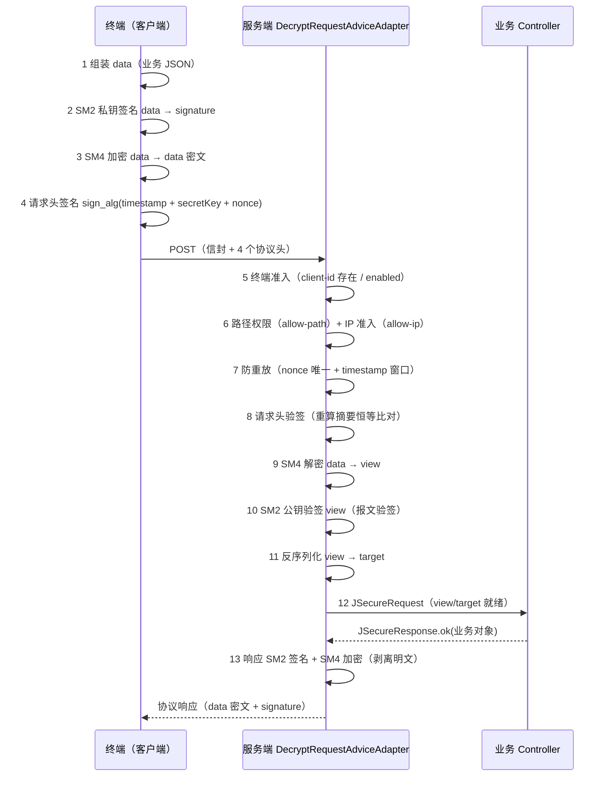
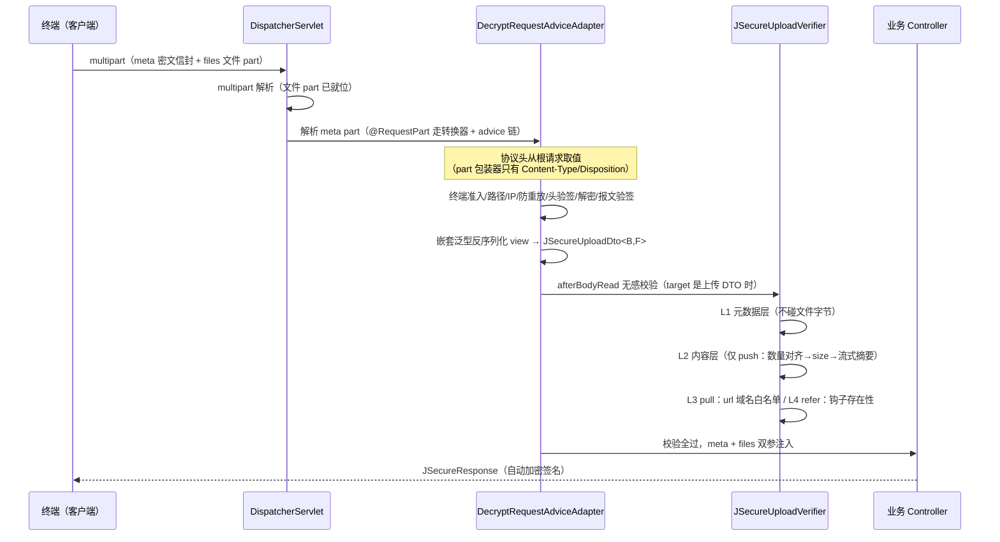

# jevokit-api-spring-boot-starter（JSecure 接口安全协议）

JSecure 协议：面向外部终端的接口安全通道——请求头验签 + 防重放 + 终端准入 + SM2/SM4 国密混合加解密 + 报文验签，
统一请求/响应信封（`@JSecureApi` + `JSecureRequest`/`JSecureResponse`）。本版本新增 **文件上传（multipart）协议化**：
meta part 装加密信封（业务参数 + 文件摘要清单），文件 part 明文传输、按摘要校验完整性，支持 push（直传）/ pull（URL 拉取）/ refer（引用已有）三种获取方式。

- [机制篇](#机制篇)
  - [协议总览（JSON 通道）](#协议总览json-通道)
  - [上传链路机制](#上传链路机制)
  - [三种 fetchMode：机制与边界](#三种-fetchmode机制与边界)
- [用法篇](#用法篇)
  - [客户端统一门面 JSecureClient](#客户端统一门面-jsecureclient)
  - [场景选择](#场景选择)
  - [场景一：JSON 接口（非文件）](#场景一json-接口非文件)
  - [场景二：push 直传](#场景二push-直传)
  - [场景三：pull URL 拉取](#场景三pull-url-拉取)
  - [场景四：refer 引用已有文件](#场景四refer-引用已有文件)
  - [场景五：混合上传](#场景五混合上传)
  - [场景六：加密上传（客户端无感加密 + 服务端无感解密）](#场景六加密上传客户端无感加密--服务端无感解密)
  - [自定义传输载体（execute 注入回调）](#自定义传输载体execute-注入回调)
  - [客户端异常语义](#客户端异常语义)
  - [双泛型 DTO 扩展指南](#双泛型-dto-扩展指南)
  - [Map 零类接入简式](#map-零类接入简式)
  - [不依赖 jevokit 的自实现对接](#不依赖-jevokit-的自实现对接)
- [配置篇](#配置篇)
- [安全篇](#安全篇)

## 机制篇

### 协议总览（JSON 通道）

现有 JSON 端点（`@RequestBody JSecureRequest<T>`）的完整防线（上传链路复用同一套，仅报文载体不同）：



任何一步失败抛 `JSecureApiException`，由统一异常出口转写为协议响应（code=999），transNo 继承请求值。

### 上传链路机制

multipart 请求的协议形态：**meta part 装加密信封，文件 part 明文传输**。

```
POST /secure/upload                      （multipart/form-data）
├─ part "meta"   （application/json）    JSecureRequest 信封：SM4 加密的 {businessData, fileDetails[]}
├─ part "files"  （filename = fileId）   文件字节 1（明文）
├─ part "files"  （filename = fileId）   文件字节 2（明文，同名 part 各自 filename 不同）
└─ 根请求头                              x-api-client-id / timestamp / nonce / signature（与 JSON 通道一致）
```

要点：文件不加密（体积与性能考虑），完整性由 meta 内的**摘要清单**保证——服务端按 `filename = fileId` 对齐后流式比对 sha256/sm3 摘要，调包（两个文件互换 fileId）、篡改、增删文件 part 均拒。

#### 时序（含无感校验时点）

`@RequestPart` 的 meta part 走与 `@RequestBody` 完全相同的消息转换器 + RequestBodyAdvice 链，业务代码零感知：



校验失败在 advice 阶段抛出，走统一异常出口返回 code=999，业务方法不会被调用。

#### 分层校验（成本递增）

| 层 | 触发条件 | 校验内容 | 失败示例消息 |
|---|---|---|---|
| 元数据层 | 所有请求（不碰文件字节） | fileId 唯一非空且**字符集白名单**（仅允许字母、数字与 `. _ -`，长度 1-128）；digestAlg ∈ 协议全集 {sha256, sm3, md5} 且在终端 `upload-digest-algorithms` 允许范围内（配置后 fail-closed）；format 终端白名单（fail-closed）；size 声明合法性与 upload-max-size 上限恒检；push 必填完整（fileId/fileType/fileName/size/digest，size/digest 必填可分别被 upload-size-verify / upload-digest-verify 关闭豁免）；**push 条目数 = 文件 part 数**（多余/缺少双向都拒）；**meta part 不重复**（同名 >1 即拒，防 first-wins 静默歧义） | `文件标识 fileId 非法（仅允许字母、数字与 . _ -…）`、`文件格式不在白名单：txt`、`meta part 重复（2 个同名 part）…`、`push 文件数(2)与文件 part 数(3)不一致` |
| 内容层 | 仅 push | 按 filename=fileId 找文件 part（找不到拒）→ 实际字节数上限恒检 → 比对声明 size（upload-size-verify=false 跳过）→ 流式摘要比对（按 digestAlg；upload-digest-verify=false 跳过） | `文件摘要校验失败（filename=inv-1）` |
| pull | fetchMode=pull | 元数据层 + **url 域名白名单**（不在白名单拒；未配置白名单且有 pull 请求直接拒，fail-fast） | `pull 文件地址不在白名单：https://…` |
| refer | fetchMode=refer | 元数据层 + 业务钩子 `JSecureUploadFileRefChecker.exists()`（容器无钩子 Bean 而出现 refer 条目即拒） | `refer 文件不存在：archived-001` |
| 边界 | target 是上传 DTO 但请求非 multipart | 装配错误 fail-fast（提示改用 meta+files 双参数形态） | `上传接口必须以 multipart 请求…` |

format 白名单的适用范围：**push 必查**（format 必填——含 format 为空的情形，空串不可能命中列表即拒，即配置了白名单的终端不接受无扩展名文件）；**pull 声明了 fileType+format 才查**（简式 pull 可省略）；**refer 不查**（文件首次上传时已校验）。未配置白名单的终端不校验 format（无校验需求，无扩展名文件如 `README` 可正常 push，format 留空不参与任何落盘/解析路径）。

### 三种 fetchMode：机制与边界

| | push（直传） | pull（URL 拉取） | refer（引用已有） |
|---|---|---|---|
| 文件来源 | 本次 multipart 文件 part | 第三方 URL | 本系统已存在文件（fileId） |
| 协议校验 | 元数据 + 内容双层（摘要比对） | 元数据 + 域名白名单 | 元数据 + 业务钩子存在性 |
| 文件字节何时到服务端 | 随请求（校验时已就位） | **业务显式调用 `JSecureFileFetcher.fetch()`**（时机是业务决策：同步/异步/重试） | 不到达（用既有存储） |
| 完整性 | 摘要比对（sha256/sm3） | 声明 size/digest，fetch 时流式复核 | 由首次上传时的校验保证 |
| 典型场景 | 移动端直传拍照件 | 文件在合作方 OSS，先报文后取件 | 关联已归档附件再提交 |

pull 拉取器（`JSecureFileFetcher`）安全边界：白名单在入口校验与拉取前**双道复核**；仅 http/https；**禁止跟随重定向**（3xx 一律拒，防 302 跳出白名单域）；下载字节数按声明 size 封顶（防超大响应拖垮内存）；fetchToken 以 `X-Fetch-Token` 头透传给源站。

## 用法篇

### 客户端统一门面 JSecureClient

调用方（终端）只扔数据拿结果：`JSecureClient.of(clientId)` 选终端，`post`/`upload` 选通道，
链式补交易要素后 `execute()`——协议组装（请求头签名 + SM2 签名 + SM4 加密）、发送与响应
解密验签反序列化全部由门面完成。

```java
// JSON 通道（@RequestBody 信封端点）
JSecureResponse<OrderVo> resp = JSecureClient.of(clientId)
        .post("https://server-host/api/order/detail", bizDto, OrderVo.class)
        .transNo("t-001").transType("QUERY")
        .execute();                        // 空参走默认载体（hutool）
OrderVo order = resp.getTarget();          // 已解密验签的业务返回

// 上传通道（meta + files 双参数端点，push/pull/refer 混合）
JSecureResponse<String> upload = JSecureClient.of(clientId)
        .upload("https://server-host/secure/upload", orderBiz, String.class)
        .transNo("t-002")
        .digestAlg("sm3")                              // 摘要算法（缺省 sha256；须在服务端
                                                      // upload-digest-algorithms 允许范围内）
        .add(invoiceFile, "inv-1", "invoice")          // push：自动算 size/format/digest（按上述算法）
        .pull("oss-1", fileUrl, size, digest)          // pull：URL 拉取（digest 按同算法声明）
        .refer("idc-10086")                            // refer：引用已有
        .execute();
```

要点：`clientId` 须在 `jevokit.api.client[]` 登记（密钥与服务端成对）；终端开启 verify 时
`execute()` 会对响应验签，失败抛 `JSecureApiException`（不返回未验签数据）；
`transType` 在服务端 `@JSecureApi` 声明了限定时必填；`transNo` 不设时通道在 prepare 阶段
自动生成 UUID 兜底（服务端 `@NotBlank` 无条件必填，客户端生成保证报文恒可过校验，回显值可用于对账）。

**fileId 字符集白名单**（push/pull/refer/entry 全入口生效，与服务端元数据层同口径）：
仅允许**字母、数字与 `. _ -`**，长度 1-128。fileId 即文件 part 的 filename（对齐键）——
含引号会在 wire 上走私出第二个 filename 属性、含 CRLF 会伪造 part 头行、中文等非白名单字符
存在解析器差异风险，一律在客户端入口抛 `JSecureApiException` fail-fast；超长值（>128 字符）同样拒绝。

#### 客户端异常语义

客户端链路的一切失败统一以 `JSecureApiException` 暴露（可诊断，不裸抛 fastjson/运行时异常）：

| 场景 | 消息要点 |
|---|---|
| 终端未登记（clientId 不在配置内） | 含 clientId，便于定位部署错误 |
| 发送失败（连接异常等） | 含 URL 与原因链 |
| HTTP 非 2xx（默认载体 hutool，网关 404/500 错误页） | 含状态码与 URL，**不回显响应体**——传输层失败与协议层失败可区分 |
| 响应解析失败（响应体非 JSON/空/截断/解密失败） | 含响应体长度与前 64 字符摘要，**不回显全量响应体**（防日志噪音与信息暴露） |
| 响应验签失败（终端开启 verify） | `返回结果验签失败` |
| fileId 非法（字符集/长度/重复） | 含合法字符集说明 |

自定义传输载体（`execute(IRequest)` / `execute(IUploadRequest)`）返回的响应体同样走统一解析处理，
上述解析/验签异常语义一致；非 2xx 检查仅默认载体内置（自定义载体自行决定传输层失败语义）。

### 场景选择

| 你的场景 | 用法 | 章节 |
|---|---|---|
| 常规业务接口：报文要机密性/完整性/防重放，**不涉及文件** | JSON 通道：`@RequestBody` 信封端点 + `JSecureClient.post()` | [场景一](#场景一json-接口非文件) |
| 文件随请求直传（拍照件/扫描件/附件） | 上传通道 push | [场景二](#场景二push-直传) |
| 文件在合作方存储（OSS/文件服务器），报文先行、服务端取件 | 上传通道 pull | [场景三](#场景三pull-url-拉取) |
| 文件此前已上传归档，本次仅引用关联 | 上传通道 refer | [场景四](#场景四refer-引用已有文件) |
| 一次请求混合上述多种文件来源 | 上传通道混用 | [场景五](#场景五混合上传) |
| 文件需加密传输（无 TLS 内网段/密文归档），两端零改造 | `add(..., true)` 无感加密 + 服务端单参数收明文 | [场景六](#场景六加密上传客户端无感加密--服务端无感解密) |

### 场景一：JSON 接口（非文件）

JSecure 协议的最基础形态：请求体整体是一个加密信封（`JSecureRequest`），无 multipart、无文件。
适用于绝大多数常规业务接口——下单、查询、对账等只需报文机密性与完整性 + 防重放 + 终端准入的场景。

**服务端**（`@JSecureApi` + `@RequestBody` 信封 + 协议响应体，三要素即接入）：

```java
@Slf4j
@RestController
@RequestMapping("/secure")
public class SecureApi {

    /** value 声明交易类型限定（可选）：客户端 transType 不在列表内即 999 拒绝 */
    @JSecureApi("QUERY")
    @PostMapping("/order/detail")
    public JSecureResponse<OrderVo> detail(@RequestBody @Valid JSecureRequest<OrderQueryDto> req) {
        // 走到这里协议链已全部通过：终端准入/IP/路径/防重放/头验签/解密/报文验签
        OrderQueryDto query = req.getTarget();          // 已解密的业务入参
        log.info("transNo={} query={}", req.getTransNo(), query);
        return JSecureResponse.ok(orderService.query(query));   // 出网自动加密+签名
    }
}
```

校验链（`DecryptRequestAdviceAdapter` 在参数绑定前完成）：终端准入（client-id 存在且启用）→ 交易类型
→ 路径权限 → IP 准入 → 防重放（nonce/timestamp）→ 请求头验签 → SM4 解密 → SM2 报文验签 → 反序列化 target。
响应侧对称处理：业务实体序列化 → SM2 签名 → 按终端开关 SM4 加密 → 剥离明文字段出网。

**客户端**：

```java
OrderQueryDto query = new OrderQueryDto("SO-2026-0001");
JSecureResponse<OrderVo> resp = JSecureClient.of("partner-a")          // 终端识别码（成对登记密钥）
        .post("https://server-host/secure/order/detail", query, OrderVo.class)
        .transNo("t-20261031-001")                                     // 不设则自动生成 UUID
        .transType("QUERY")                                            // 服务端声明了限定则必填
        .execute();
if (resp.getCode().equals("0")) {
    OrderVo order = resp.getTarget();                                  // 已解密验签的业务返回
} else {
    log.warn("业务失败：code={} message={}", resp.getCode(), resp.getMessage());
}
```

**请求/响应报文形态**（HTTP body 即加密信封 JSON，无 multipart）：

```json
// 请求体（data 为 SM4 密文；signature 为明文 data 的 SM2 签名）
{"transNo":"t-20261031-001","transType":"QUERY","data":"U2FsdGVk…","signature":"MEUCIQ…"}
// 响应体（对称形态：data 密文 + signature；view/target 等明文字段不序列化出网）
{"transNo":"t-20261031-001","code":"0","message":"success","data":"U2FsdGVk…","signature":"MEUCIQ…"}
```

与文件上传的关系：上传场景（场景二~五）是本场景在 multipart 上的扩展——业务参数与文件摘要清单
装进同一个加密信封（`JSecureUploadDto`），作为 meta part 随文件传输；协议头、防重放、终端准入等
通道校验两者完全一致。

### 场景二：push 直传

**服务端**（meta + files 双参数形态，`files` 建议 `required = false` 以兼容纯 pull/refer 请求）：

```java
@Slf4j
@RestController
@RequestMapping("/secure")
public class SecureUploadApi {

    /** 双泛型：B=业务数据类型，F=文件条目类型（无扩展直接用 JSecureUploadFileDetailDto） */
    @JSecureApi
    @PostMapping("/upload")
    public JSecureResponse<String> upload(
            @RequestPart("meta") @Valid JSecureRequest<JSecureUploadDto<UploadOrderVo, JSecureUploadFileDetailDto>> meta,
            @RequestPart(value = "files", required = false) List<MultipartFile> files) {
        // 走到这里协议校验已全部通过：摘要清单与文件 part 一一对齐且摘要一致
        JSecureUploadDto<UploadOrderVo, JSecureUploadFileDetailDto> upload = meta.getTarget();
        log.info("orderNo={}, 声明文件数={}, 实际文件 part 数={}",
                upload.getBusinessData().getOrderNo(),
                upload.getFileDetails().size(), files == null ? 0 : files.size());
        // 持久化注意：fileName 仅展示、永不落盘，存储名用服务端生成值（见安全篇）
        return JSecureResponse.ok("accepted");
    }
}
```

**客户端**（`JSecureClient` 上传通道自动算 size/format/digest 并组装信封、协议头与文件 part，空参 `execute()` 走默认载体）：

```java
UploadOrderVo biz = UploadOrderVo.builder().orderNo("BX-2026-0001").amount(199.0).build();
JSecureResponse<String> response = JSecureClient.of("upload-partner")     // 终端识别码
        .upload("https://server-host/secure/upload", biz, String.class)
        .transNo(UUID.randomUUID().toString())                     // 不设则自动生成 UUID
        .add(invoiceFile, "inv-1", "invoice", "发票.pdf")        // File：自动算 size/format/digest（sha256）
        .add(idCardBytes, "id-1", "id_card", "身份证.jpg")       // byte[]：自动算摘要
        .execute();                                              // hutool 默认载体直发
// response.getTarget() → "accepted:2/2"（已解密验签的受理结果）
```

> fileId 要点：仅允许**字母、数字与 `. _ -`**（长度 1-128，见上"fileId 字符集白名单"）。
> fileName 的扩展名用于推断 format（无扩展名如 `README` 时 format 留空）：终端配置了
> format 白名单则该类文件被拒（没法比对），未配置白名单则照常受理。

> 要点：门面默认载体（hutool）产出的 multipart 与服务端期望严格一致——meta part 无 filename
> 且 `Content-Type: application/json`，文件 part 名恒为 `files`、filename = `fileId`（对齐键），
> 协议头挂在**根请求**上（不是 part 上）。自选 HTTP 客户端时见
> [自定义传输载体](#自定义传输载体execute-注入回调)。

**请求报文形态**（multipart 展开示意）：

```
--boundary
Content-Disposition: form-data; name="meta"
Content-Type: application/json

{"transNo":"7c1e…","transType":null,"signature":"MEUCIQ…","data":"U2FsdGVk…（SM4 密文：{\"businessData\":{…},\"fileDetails\":[…]）}"}
--boundary
Content-Disposition: form-data; name="files"; filename="inv-1"
Content-Type: application/octet-stream

（发票文件字节）
--boundary
Content-Disposition: form-data; name="files"; filename="id-1"
Content-Type: application/octet-stream

（身份证文件字节）
--boundary--
```

### 场景三：pull URL 拉取

```java
// 服务端端点与场景二相同（fetchMode 在条目里声明，服务端按模式分支校验）
// 客户端：声明远端文件（域名必须在终端 upload-fetch-url-whitelist 内）
JSecureResponse<String> response = JSecureClient.of("upload-partner")
        .upload("https://server-host/secure/upload", biz, String.class)
        .transNo(UUID.randomUUID().toString())
        .pull("remote-1", "https://cdn.partner.com/invoice/a.pdf?sign=abc",
              102400L, "3b2f…（hex 摘要，可空）", "invoice", "pdf")
        .execute();

// 业务侧需要文件内容的时机显式拉取（同步/异步/重试是业务决策，框架不做时机决策）：
byte[] content = jSecureFileFetcher.fetch(meta.getTarget().getFileDetails().get(0));
// fetch 内部：白名单复核 → X-Fetch-Token 透传（条目声明了才发）→ size 预检 → 流式摘要复核 → 返回字节
```

### 场景四：refer 引用已有文件

```java
// 1. 业务实现存在性钩子并注册为 Bean（ObjectProvider 自动发现，无额外配置）
@Component
public class InvoiceFileRefChecker implements JSecureUploadFileRefChecker {
    @Override
    public boolean exists(JSecureUploadFileDetailDto file) {
        return invoiceAttachmentMapper.selectCountByFileId(file.getFileId()) > 0;
    }
}

// 2. 客户端只报 fileId
JSecureResponse<String> response = JSecureClient.of("upload-partner")
        .upload("https://server-host/secure/upload", biz, String.class)
        .transNo(UUID.randomUUID().toString())
        .refer("archived-001")
        .execute();
// 服务端：钩子判定存在 → 放行；容器无钩子 Bean 或判定不存在 → 拒（fail-fast）
```

### 场景五：混合上传

一次请求同时携带三种条目（push 文件随 multipart 发送，pull/refer 只在清单里声明）：

```java
JSecureResponse<String> response = JSecureClient.of("upload-partner")
        .upload("https://server-host/secure/upload", biz, String.class)
        .transNo(UUID.randomUUID().toString())
        .add(invoiceFile, "inv-1", "invoice", "发票.pdf")                            // push
        .pull("remote-1", "https://cdn.partner.com/合同.pdf", null, null, null, null) // pull
        .refer("archived-001")                                                       // refer
        .execute();
// 校验按条目各自的模式分层执行；push 条目数仍须等于文件 part 数
```

### 场景六：加密上传（客户端无感加密 + 服务端无感解密）

文件机密性要求高于通道保障（无 TLS 的内网段、密文需长期归档）时，`add(..., true)` 一步启用——
明文进来、明文出去，加密解密都在协议层内部完成：

```java
// 客户端：传明文，第 5 参 encrypt=true
JSecureResponse<String> response = JSecureClient.of("upload-partner")
        .upload("https://server-host/secure/upload", biz, String.class)
        .transNo(UUID.randomUUID().toString())
        .add(plainBytes, "inv-1", "invoice", "发票.pdf", true)   // SM4-CBC 内部加密
        .execute();
```

内部行为：明文以**终端 SM4 密钥**做 SM4-CBC 加密（随机 16 字节 IV 前缀，风格与协议信封一致），
密文字节作为文件 part；`digest` 按**加密前明文**计算、`size` 为密文字节数（wire 实际大小）、
条目置 `encrypted=true`（在签名信封内，不可伪造）。

```java
// 服务端：姿势一（推荐）——单 meta 参数，校验链解密后从条目直接拿明文
@JSecureApi
@PostMapping("/upload")
public JSecureResponse<Receipt> upload(
        @RequestPart("meta") @Valid JSecureRequest<JSecureUploadDto<OrderBiz, JSecureUploadFileDetailDto>> meta) {
    byte[] plain = meta.getTarget().getFileDetails().get(0).getPlainContent();   // 已解密、已复核
}
// 姿势一不写 files 参数：文件 part 无须绑定，part 名也无需固定（服务端识别一切非 meta 的文件 part）
// 姿势二（兼容）：保留 List<MultipartFile> 双参数——files 拿到的是密文原文，明文仍从条目取
```

校验链对加密条目的处理：size 比对（密文字节）→ 终端密钥解密（密文损坏/密钥不符即拒）→
按**解密后明文**复核 digest → 明文字节填充 `plainContent`。`upload-digest-verify=false` 只豁免
摘要复核，**解密与 plainContent 填充恒执行**（业务依赖明文视图）。

边界：加密条目仅支持 push（pull/refer 条目声明 `encrypted=true` 即拒）；明文上传（缺省 false）
行为完全不变；CBC 无自身认证性——传输完整性由 digest 复核兜底（改密文必坏明文、摘要必失配），
长期归档场景建议通道层 TLS 或业务侧再加固。

### 自定义传输载体（execute 注入回调）

空参 `execute()` 走默认载体（hutool HttpRequest：JSON 报文 = 协议头 headerMap + JSON body；
multipart = meta part[application/json] + 逐文件 form "files" 且 filename=fileId）。
需要自选 HTTP 客户端（OkHttp/RestTemplate）、接管超时/重试/连接池时，把"实际发送"注入回调——
门面只做协议组装与结果解析，不绑死任何客户端；回调返回密文信封原文，解密验签仍由门面完成。

```java
// JSON 通道：IRequest 回调 (url, body, headers) → 响应体字符串
JSecureResponse<OrderVo> resp = JSecureClient.of(clientId)
        .post("https://server-host/api/order/detail", bizDto, OrderVo.class)
        .transNo("t-001").transType("QUERY")
        .execute((url, body, headers) -> OkHttpUtil.of().postJson(url, body, headers));

// 上传通道：IUploadRequest 回调 (url, payload) → 响应体字符串，payload 三要素组装 multipart（OkHttp 完整样例）
JSecureResponse<String> upload = JSecureClient.of(clientId)
        .upload("https://server-host/secure/upload", biz, String.class)
        .transNo("t-002")
        .add(invoiceFile, "inv-1", "invoice", "发票.pdf")
        .execute((url, payload) -> {
            // 1. 组装 multipart 体：meta part + 逐文件 part（part 名恒为 "files"，filename = fileId）
            MultipartBody.Builder bodyBuilder = new MultipartBody.Builder()
                    .setType(MultipartBody.FORM)
                    .addFormDataPart("meta", null,
                            RequestBody.create(payload.getMetaJson(), MediaType.parse("application/json")));
            for (JSecureUploadRequest.FilePart f : payload.getFiles()) {
                bodyBuilder.addFormDataPart("files", f.getFileId(),         // filename = fileId（服务端按它对齐）
                        RequestBody.create(f.getContent(), MediaType.parse("application/octet-stream")));
            }
            // 2. 协议头 4 件套挂到根请求（client-id/timestamp/nonce/signature，原样透传）
            Request.Builder reqBuilder = new Request.Builder().url(url).post(bodyBuilder.build());
            payload.getHeaders().forEach(reqBuilder::addHeader);
            // 3. 发送，密文信封交回门面解密验签
            try (Response resp = okHttpClient.newCall(reqBuilder.build()).execute()) {
                return resp.body().string();
            }
        });
```

> 要点（自定义载体三不）：meta 的 `Content-Type` 必须**是** `application/json`（服务端按它路由到消息转换器）
> 且不带 filename；文件 part 名必须**恒为** `files`、filename 必须等于 meta 里声明的 `fileId`（对齐键）；
> 协议头必须挂**根请求**上（不是 part 上）。`metaJson` 是密文信封，须原样发送，不可再转义/拼接。

### 双泛型 DTO 扩展指南

`JSecureUploadDto<B, F extends JSecureUploadFileDetailDto>` 两个泛型都可扩展：

```java
/** B：业务数据自由定义 */
@Data
public class UploadOrderVo { private String orderNo; private Double amount; }

/** F：文件条目可加业务字段（继承 JSecureUploadFileDetailDto） */
@Data
@EqualsAndHashCode(callSuper = true)
public class InvoiceFileDto extends JSecureUploadFileDetailDto {
    private Integer invoicePageNo;   // 业务扩展字段
}

/** Controller 声明具体泛型，服务端反序列化与校验自动生效 */
@JSecureApi
@PostMapping("/upload")
public JSecureResponse<String> upload(
        @RequestPart("meta") @Valid JSecureRequest<JSecureUploadDto<UploadOrderVo, InvoiceFileDto>> meta,
        @RequestPart(value = "files", required = false) List<MultipartFile> files) { … }

/** 客户端用 entry() 全自定条目（sm3 摘要、扩展字段等） */
JSecureClient.of(clientId)
        .upload("https://server-host/secure/upload", biz, String.class)
        .transNo(UUID.randomUUID().toString())
        .entry(InvoiceFileDto.of("inv-1", …, "sm3"), invoiceBytes)   // 第二参为 push 内容
        .execute();
```

### Map 零类接入简式

不想定义业务类时，`B` 直接用 `Map`（`F` 用默认条目类），报文结构与强类型完全一致：

```java
// 客户端
JSecureResponse<String> response = JSecureClient.of(clientId)
        .upload("https://server-host/secure/upload",
                Map.of("orderNo", "BX-001", "amount", 199.0), String.class)
        .transNo(UUID.randomUUID().toString())
        .add(bytes, "inv-1", "invoice", "发票.pdf")
        .execute();

// 服务端
@JSecureApi
@PostMapping("/upload")
public JSecureResponse<String> upload(
        @RequestPart("meta") @Valid JSecureRequest<JSecureUploadDto<Map<String, Object>, JSecureUploadFileDetailDto>> meta,
        @RequestPart(value = "files", required = false) List<MultipartFile> files) {
    Map<String, Object> biz = meta.getTarget().getBusinessData();
    …
}
```

### 不依赖 jevokit 的自实现对接

合作方项目**不引 jevokit jar**、要用自有国密设施自行封装客户端时，按本节的协议规格实现即可对接
（JSecureClient 需要引 jevokit 依赖，本节是它的"脱离版"等价路径）。完整可运行的单文件参考实现见
本节末尾的引用链接，下述规格均已在当前版本（3.5.3.0-SNAPSHOT）实测通过。

#### 依赖说明（零依赖做不到）

协议算法为 SM2/SM4 国密，JDK 原生不支持，最小依赖 = **BouncyCastle（bcprov）**；JSON 处理用与
jevokit 全线同款的 **fastjson2**（参考实现选它以对齐 jevokit、降低对照成本）：

```xml
<dependency>
    <groupId>org.bouncycastle</groupId>
    <artifactId>bcprov-jdk18on</artifactId>
    <version>1.86</version> <!-- 对齐 jevokit BOM 的 bouncycastle 版本 -->
</dependency>
<dependency>
    <groupId>com.alibaba.fastjson2</groupId>
    <artifactId>fastjson2</artifactId>
    <version>2.0.53</version> <!-- 对齐 jevokit BOM 的 fastjson2 版本 -->
</dependency>
```

JSON 库可任选：服务端解析只认信封**字段名**，容忍字段顺序与多余字段（`transType` 缺省或显式
null 均可）——对接方用 Jackson/Gson 亦可，参考实现用 fastjson2 仅为与 jevokit 同款。

#### 协议规格（自实现依据，与服务端实现逐字节对齐）

**1. 数据加密（信封 `data` 字段）**

| 项 | 规格 |
|---|---|
| 算法 | SM4/CBC/PKCS#7 填充（JCE 名写 `PKCS5Padding`，16 字节块两者等价） |
| 密钥 | 终端 `secret-key-sm4`（缺省回落 `secret-key`）的**字符字节**（16 字符 ASCII），不做 hex 解码等二次处理 |
| IV | **每次加密随机生成 16 字节，前置在密文前**（不是固定 IV、不由密钥派生）；解密取前 16 字节 |
| 明文编码 | UTF-8 |
| 输出 | `Base64(IV ‖ 密文)`，标准字母表、无换行 |

**2. 报文签名（信封 `signature` 字段）**

| 项 | 规格 |
|---|---|
| 算法 | `SM3withSM2`（BC 的 SM2 签名 + SM3 摘要） |
| userId | 双方都用**缺省值 `1234567812345678`**（国密标准缺省 ID），不要自设 |
| 签名编码 | **DER**（ASN.1 `SEQUENCE{r,s}`）后再 Base64 —— 不是裸 64 字节 `r‖s` |
| 私钥格式 | PKCS#8 / Base64（请求签名用） |
| 公钥格式 | X.509 SubjectPublicKeyInfo / Base64（响应验签用） |
| 签名原文 | **加密前的业务明文 JSON 字符串本身**（不是密文！响应侧同理：对解密出的明文验签） |
| 字符集 | 签名原文取字节的口径由 `jevokit.crypto.charset` 配置（**默认 UTF-8**，3.5.3.0 起配置化，不再跟随 JVM 默认字符集），按 UTF-8 实现即可与默认配置互通；**验签互通要求两端配置一致**——任一端不同，含非 ASCII 字符（如中文）的报文即验签失败（纯 ASCII 报文/密文/签名值本身不受影响）；对接 GBK 存量系统时需两端同时配 `charset: GBK`（非法字符集名启动即失败）。参考实现按 UTF-8 写死，与默认配置一致 |

**3. 请求头签名（MAC）与协议头四件套**

| 头名（默认前缀 `x-api`，实际名 = `前缀 + - + 名`） | 值 |
|---|---|
| `x-api-client-id` | 终端识别码（与服务端登记 id 全等） |
| `x-api-timestamp` | **秒级**时间戳（10 位数字） |
| `x-api-nonce` | 随机码，10 分钟窗口内唯一（任一每次不同的字符串，UUID 即可；防重放开启时同值二次到达即拒） |
| `x-api-signature` | MAC 值（下述配方） |

| 项 | 规格 |
|---|---|
| MAC 原文 | `timestamp + secretKey + nonce` —— **顺序固定：时间戳、密钥、随机码**，无分隔符、无大小写变换、原样拼接 |
| MAC 算法 | 终端 `header.sign-alg`：MD5（缺省）或 SHA-256，与服务端保持一致 |
| MAC 输出 | **hex 小写**（不是 Base64） |
| 时间窗口 | 与服务端时差超 10 分钟判过期（防重放开启时）；timestamp 须秒级 |
| 头名拼接 | 前缀已以 `-` 结尾直接拼名，否则补 `-`；HTTP 头名大小写不敏感 |

**4. 信封结构与密钥关系**

```json
// 请求信封（JSON 通道 body；上传通道为 meta part 内容）
{"transNo":"…","transType":"…","signature":"<明文 data 的 SM2 签名>","data":"<SM4 密文>"}
// 响应信封
{"transNo":"…","transType":"…","code":"0","message":"成功","signature":"…","data":"…"}
```

- `transNo` 必填非空（UUID 即可，响应原样回显）；`transType` 在服务端 `@JSecureApi` 声明了限定时必填；
  `code` 为 `"0"` 成功、`"999"` 失败（失败原因在 `message`）。
- 响应处理顺序：解析信封 → 判 code → `data` 解密得业务明文 → **对明文**做 SM2 验签。
- 密钥四件套（`secret-key` / `secret-key-sm4` / `private-key` / `public-key`）由服务端发放、双端登记同值：
  客户端用 `private-key` 签请求、`public-key` 验响应、`secret-key` 拼头 MAC、`secret-key-sm4` 做数据加密。

**5. 上传通道 multipart 形态**

```
POST（multipart/form-data，boundary 任意，协议头挂根请求）
├─ part "meta"   Content-Type: application/json（不带 filename！）
│    内容 = 请求信封 JSON，其中 data 为 {"businessData":<业务JSON>,"fileDetails":[<文件明细清单>]} 的 SM4 密文
└─ part "files"  filename = fileId（对齐键，仅 [A-Za-z0-9._-]，1-128 字符）
     Content-Type: application/octet-stream，文件字节明文传输
```

文件明细条目字段（fileDetails 数组元素，文件完整性契约，push 模式）：

```json
{"fileId":"inv-1","fileType":"invoice","fileName":"发票.pdf","format":"pdf",
 "size":123,"digest":"<sha256 hex 小写>","digestAlg":"sha256","fetchMode":"push"}
```

（push 条目数必须等于文件 part 数；`format` 取小写扩展名，终端配了 format 白名单则必须命中。
`digestAlg` 可选 sha256 / sm3 / md5，缺省 sha256；终端配了 `upload-digest-algorithms` 则必须落在允许范围内，否则拒绝并提示允许清单。
注意 md5 抗碰撞弱（chosen-prefix 碰撞已可廉价预制），仅适合遗留互操作与误传检测，不应作为防恶意替换或存证/对账依据——生产建议范围收紧为 `[sha256, sm3]`。）

#### 参考实现（单文件，可直接发给对接方）

**[→ JSecureProtocolDemo.java（点击查看完整源码）](src/test/java/io/github/jevonsnotes/jevokit/api/selfimplement/JSecureProtocolDemo.java)**

一个自包含的 Java 类，包含对接所需的**全部可直接运行的逻辑**——国密工具（SM4 加解密 / SM2 签名验签 /
请求头 MAC / 密钥加载）、信封组装、协议头、JSON 通道与上传通道（含手工 multipart）的完整请求发送与
响应解密验签，以及一个 `main` 方法。把它直接发给对接方即可：

- **依赖两个坐标**：`org.bouncycastle:bcprov-jdk18on` + `com.alibaba.fastjson2:fastjson2`（见上节坐标）；JDK 17+；不含任何 jevokit/hutool 类（JSON 用与 jevokit 同款的 fastjson2，对接方换 Jackson/Gson 亦可，字段名一致即可）
- **使用三步**（`main` 方法注释同样写明）：① 把 `main` 里的服务端地址与终端配置（构造参数：clientId、
  secretKey、SM4 密钥、SM2 公私钥）换成 `jevokit.api.client[]` 登记的真实值；② 运行 `main`；
  ③ 控制台输出 JSON 通道与上传通道的完整往返结果（示例指向 jevokit-sample 端点，须放行 allow-path/allow-ip）
- **口径可信**：类中各方法的字节级实现与上述协议规格逐项对齐，并由同目录 `JSecureProtocolDemoTest`
  （真实容器往返 + 与 jevokit 实现的字节级互验）常驻回归——协议口径调整时该测试先红，本节随之更新

> 类以"测试源码"身份放在模块 test 目录（随仓库演进、受回归保护），它本身是纯 main 程序，
> 不依赖任何测试框架，脱离本仓库单独编译运行完全没问题。

#### 常见坑（服务端报错 → 原因 → 排查）

| 服务端报错（code=999 message） | 典型原因 | 排查 |
|---|---|---|
| `请求头验签失败` | MAC 拼接顺序/分隔符错、算法不一致（md5 vs sha256）、输出用了 Base64 或大写 hex、secretKey 不一致 | 服务端 ERROR 日志会同时打出 expected/actual 两个摘要，复算对不上即配方错 |
| `接口解密失败：BadPaddingException: pad block corrupted` | SM4 密钥不一致（须 16 字节字符）、IV 未前置/解密取位错、padding 用错、Base64 变体错 | 用同密钥本地自解密自测；确认密文 = Base64(IV‖密文) |
| `请求体验签失败` | 私钥与服务端公钥不配对、签名编码用裸 r‖s（须 DER）、userId 自设了非缺省值、**签了密文而不是明文原文** | 按规格 2 逐项对照 |
| `重复请求或已失效，请调整相关访问参数` | nonce 在 10 分钟窗口内重复、timestamp 超 10 分钟或误用毫秒级 | timestamp 用秒级；nonce 每次随机 |
| `终端信息不存在或已关闭访问策略` | `x-api-client-id` 值与登记 id 不一致或终端 enabled=false | 核对终端识别码头 |
| `终端无该接口访问权限` / `终端IP无该接口访问权限` | allow-path / allow-ip 未放行 | 服务端加白（allow-ip 支持 `203.0.113.*` 通配） |
| `接口交易类型不匹配` | transType 缺失或不在 `@JSecureApi` 限定内 | 按接口声明传 |
| 客户端侧 `返回结果验签失败` | 拿密文/信封 JSON 验签（应验**解密后的明文**）、公钥与响应私钥不同对 | 先解密 data 再验签 |
| 含中文报文验签失败（环境相关） | 两端 `jevokit.crypto.charset` 配置不一致，或对接方按另一字符集口径编码报文（见规格 2 字符集） | 3.5.3.0 起字符集配置化（默认 UTF-8）：两端配置相同字符集即可；GBK 存量对接两端同配 `jevokit.crypto.charset=GBK` |
| `文件摘要校验失败（filename=…）` | digest 与实际字节不符（sha256 须 hex 小写）、part filename ≠ fileId | 重算摘要；filename 用 fileId |
| `push 文件数(N)与文件 part 数(M)不一致` | 漏发/多发文件 part，或清单与 part 未一一对应 | 清单条目数 = 文件 part 数 |
| `文件格式不在白名单：…` | format 不在终端 upload-format-whitelist（含无扩展名空串） | 按白名单传 format（小写扩展名） |

## 配置篇

终端级配置全部挂在 `jevokit.api.client[]` 下（与其他协议配置同层，按终端独立生效）：

```yaml
jevokit:
  api:
    client:
      - id: upload-partner          # 终端识别码
        secret-key: 0123456789abcdef          # 头签名密钥（16 字节演示值，生产必须替换）
        secret-key-sm4: 0123456789abcdef      # SM4 密钥（缺省回落 secret-key；生产必须替换）
        private-key: <sm2-private-key>        # 生产必须替换为密钥对
        public-key: <sm2-public-key>          # 生产必须替换为密钥对
        verify: true                          # 报文验签
        prevent-replay: true                  # 防重放
        allow-path: ["/secure/upload/**"]     # 路径白名单
        allow-ip: ["203.0.113.*"]             # IP 白名单

        # ---------- 文件上传（本组件新增键） ----------
        upload-max-size: 5242880              # 单文件大小上限（字节），缺省 50MB（保守值）；
                                            # 上限恒生效——校验开关也不豁免（配多少就是多少）；
                                            # 容器限值须配平：spring.servlet.multipart.max-file-size
                                            # ≤ 本值（失当启动打 WARN——容器先落盘协议层才拒）
        upload-max-file-count: 20             # 单请求文件条目数上限（合计），缺省 20；0/负数=不限制
        upload-digest-algorithms: [sha256, sm3]  # 摘要算法允许范围；缺省空=全集 sha256/sm3/md5，
                                            # 配置后 fail-closed（客户端用范围外算法即拒并提示允许清单）
        upload-digest-verify: true            # 摘要校验开关；false=跳过 push 摘要比对、
                                            # pull 拉取复核与 digest 必填（可信内网评估后关闭）
        upload-size-verify: true              # 大小一致性开关；false=跳过 size 必填与"声明=实际"比对
        upload-format-whitelist:              # format 白名单：key=fileType；缺省空=不限制；
          invoice: [pdf, jpg, png]            #   配置后 fail-closed（未列 fileType/格式一律拒）
          id_card: [jpg, png]
        upload-fetch-url-whitelist:                  # pull 域名白名单（SSRF 硬防线）：
          - files.partner.com                 #   精确域名或 *.partner.com 通配子域；
          - "*.oss.partner.com"               #   缺省空=所有 pull 请求一律拒（fail-fast）
```

| 配置键 | 类型 | 缺省 | 说明 |
|---|---|---|---|
| `jevokit.api.client[].upload-max-size` | long | 50MB（52428800） | 单文件大小上限，push 元数据预检与 pull 下载预检共用；**恒生效不受校验开关豁免**。容器配平：`spring.servlet.multipart.max-file-size` 须 ≤ 本值（失当启动打 WARN：容器会先把超限字节全额落临时盘、协议层才拒绝，资源消耗面=容器限值） |
| `jevokit.api.client[].upload-max-file-count` | int | 20 | 单请求文件条目数上限（push/pull/refer 合计）：防"N 个单文件均合法"的聚合流量放大；0 或负数 = 不限制 |
| `jevokit.api.client[].upload-format-whitelist.<fileType>[n]` | Map<String, List<String>> | 空（不限制） | format 白名单，配置后 fail-closed（含 format 为空的情形即无扩展名文件必拒）；未配置不校验 format（无扩展名文件可 push）；push 必查、pull 声明了才查、refer 不查 |
| `jevokit.api.client[].upload-digest-algorithms[n]` | List<String> | 空（全集 sha256/sm3/md5） | 摘要算法允许范围，配置后 fail-closed：条目 digestAlg 范围外即拒（消息带允许清单）；配置笔误名与全集求交后收窄（fail-closed 方向，不扩权）；缺省算法仍是 sha256（条目不声明 digestAlg 按 sha256）。**md5 抗碰撞弱，仅遗留互操作场景显式放开，生产建议 [sha256, sm3]** |
| `jevokit.api.client[].upload-digest-verify` | boolean | true | 摘要校验开关；false 跳过：push 摘要比对、pull 拉取后复核、push digest 必填。关闭后传输完整性仅剩 size 防线（若 size 开关也关则无内容校验），仅可信内网/大文件场景评估后关闭 |
| `jevokit.api.client[].upload-size-verify` | boolean | true | 大小一致性开关；false 跳过：push size 必填、"声明=实际"比对（push part 实际字节数与 pull 下载后字节数）。**不豁免 upload-max-size 上限**（上限与 pull 下载内存封底恒生效） |
| `jevokit.api.client[].upload-fetch-url-whitelist[n]` | List<String> | 空（pull 全拒） | pull 拉取域名白名单，支持 `*.domain` 通配 |
| `jevokit.crypto.charset` | String | `UTF-8` | SM2 签名/验签原文与 AES/SM4 密钥字符串取字节的字符集（jevokit-core 层配置，签名链路 `sm2Base64Sign`/`sm2Base64Verify` 与 jevokit-api 信封签验共用同一口径；3.5.3.0 新增，替代"跟随 JVM 默认字符集"旧行为）。**验签互通要求两端配置一致**：任一端不同，含非 ASCII（中文）报文即验签失败（纯 ASCII 报文不受影响）；GBK 存量对接需两端同配 `GBK`；非法字符集名应用启动即失败（fail-fast）。SM4/AES 密文内的明文编码由底层固定 UTF-8，不受本配置影响 |

上述演示值（16 字节演示密钥、演示域名）仅为开箱可跑，**生产必须替换**。既有配置键（access 令牌门、client 密钥组、header 前缀、print 开关等）见主 README [api 小节](../../README.md#api)。

## 安全篇

- **SSRF 白名单（pull 硬防线）**：pull 条目 url 的域名必须在终端 `upload-fetch-url-whitelist` 内，未配置白名单而有 pull 请求直接拒绝（fail-fast，不静默放行）；拉取时二次复核白名单，且仅允许 http/https、**禁止跟随重定向**（3xx 即拒，防 302 跳出白名单域），下载字节数按声明 size 封顶。白名单域名的 DNS 解析须受控（A 记录被改指内网/回环即白名单被"合法绕过"，必要时可加固为解析后 IP 拒私网段）。
- **pull 完整性依赖调用方如实声明 digest**：不声明 digest 的 pull 条目，`fetch()` 拉回内容仅有 size 一道弱核验，源站内容被换不可检测——对完整性有要求的 pull 场景必须声明 digest。
- **fileId 字符集白名单（双道防线）**：fileId 即文件 part 的 filename（对齐键），客户端入口（`add`/`pull`/`refer`/`entry`）与服务端元数据层按同一口径校验——仅允许字母、数字与 `. _ -`，长度 1-128；含引号（filename 走私）、CRLF（part 头注入）、中文/斜杠/超长等一律拒绝。服务端一道防的是绕过客户端白名单的自定义载体/手工报文。
- **meta part 唯一性**：同名 meta part 数量 >1 即拒（Spring `@RequestPart` 对同名 part 取第一个、第二个被无声忽略，属 first-wins 静默歧义，安全组件不受理不可确信的报文）。
- **fileName 永不落盘**：`JSecureUploadFileDetailDto.fileName` 仅为展示用途（原始名可能含路径穿越片段 `../../`、非法字符或超长内容），持久化命名一律使用服务端生成的新名（如 `fileId + 服务端序号 + 白名单内扩展名`），并在展示时对原始名做 XSS 转义。
- **fetchToken 脱敏**：协议链路日志（请求明文打印）输出摘要清单时自动脱敏——fetchToken 前 4 后 4 明文、中间掩码；url 查询串（常含签名/临时凭证）整体遮蔽为 `?***`。业务对象本身不受影响。
- **裸奔检测（启动期防线）**：`@JSecureApi` 方法若以裸 `MultipartFile` 收参（不走加密信封、无摘要校验，即静默裸奔），应用**启动即失败**并给出修复指引（改用 meta+files 双参数形态）。检测覆盖单值 / `List` / 数组三种参数形态；普通（非 JSecure）multipart 端点不受影响。
- **完整性（防调包/篡改/增删）**：push 条目数与文件 part 数双向相等；`filename = fileId` 一一对齐；size 与摘要逐个流式复核——两文件互换 fileId（调包）、字节篡改、偷加/漏发文件 part 均拒。
- **传输机密性边界**：文件 part 为明文传输（性能权衡），机密性要求高的场景应在通道层（TLS）保障，或业务侧对文件自行加密后走 push；业务参数（businessData）始终在 SM4 加密信封内。
